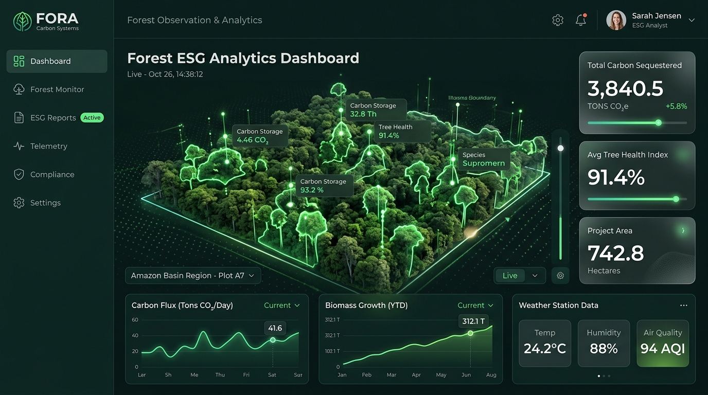
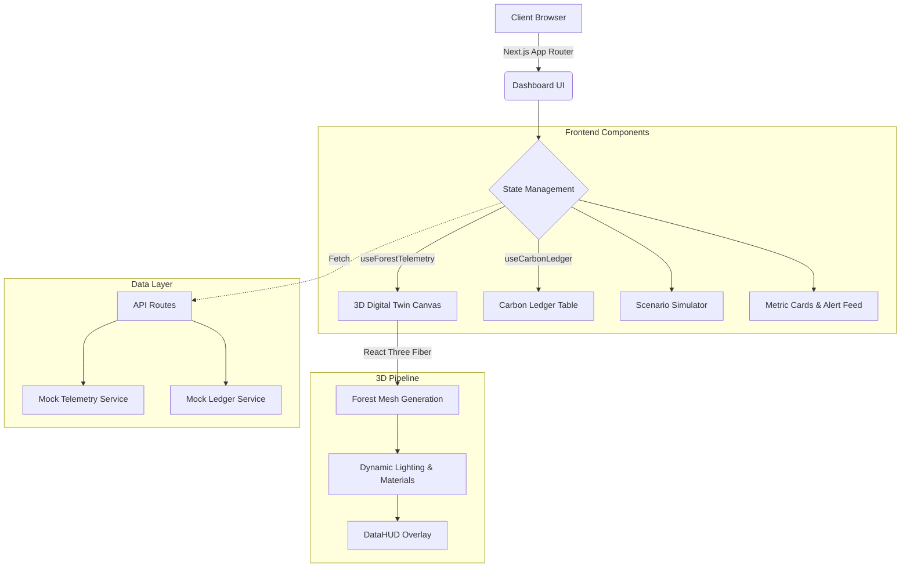

<div align="center">
  

  # ForestTwin: Digital Twin Carbon Asset Dashboard

  <p>
    <strong>An interactive forest and carbon dashboard prototype built with Next.js and mock data.</strong>
  </p>

  <p>
    <a href="https://digitaltwinfw.netlify.app/"><b>View Live Demo</b></a> •
    <a href="https://github.com/TechTideOhio/SustainableFW"><b>View Source</b></a> •
    <a href="https://techtideai.io"><b>TechTide AI</b></a>
  </p>

  <p>
    <a href="https://nextjs.org/">
      
    </a>
    <a href="https://opensource.org/licenses/MIT">
      
    </a>
  </p>
</div>

---

## Why this exists

**What it does.** ForestTwin is a Next.js 16 App Router prototype of a forest and carbon dashboard built by [TechTide AI](https://techtideai.io) and [Alex Cinovoj](https://alexcinovoj.com): a React Three Fiber forest scene, simulated telemetry cards and overlays, scenario sliders, a mock carbon-ledger table, and an example alert feed. Its two API routes (`app/api/forest-telemetry`, `app/api/carbon-ledger`) return mock data. It does not verify carbon credits, connect to real forest sensors, or provide production authentication.

**Who it serves.** Product and engineering teams that need an interactive front end to show stakeholders what a forest-carbon monitoring dashboard could look like before any data pipeline, MRV integration, or authentication exists, and front-end developers who want a reference for 3D canvas fallbacks and reduced-motion handling in Next.js.

**Why Alex built it.** Rationale not recorded in repository history; see Proposed use case below. The history records facts but not the motive: the project was uploaded on 2025-06-09 (`67bdf7c` "Initial commit" followed by a series of "Add files via upload" commits), received an SEO and blog pass on 2026-08-01 (`7224e06` "feat: full SEO overhaul for August 2026"), and on 2026-10-20 its README was rewritten to describe the app as a mock-data prototype rather than a production platform (`d6a0499` "fix: stop claiming unverified Netlify deploy success", PR #5; `fba2700` "docs: clarify validation and deployment readiness", PR #6).

**Real-world use case (2025-2026 evidence).** **Proposed use case.** A sustainability or forestry team planning a digital-twin monitoring, reporting, and verification (MRV) system uses ForestTwin as the UI prototype to agree on screens (forest state view, carbon ledger, scenario controls, alert feed) before investing in data acquisition. The 2025-2026 literature describes what a real system behind such a UI needs and what this prototype does not implement: a persistent, versioned tree-wise state updated by observations and models, with explicit uncertainty and auditor-facing verification[^1]; a layered architecture from drone and IoT sensing through AI modeling to stakeholder dashboards and milestone verification[^2]; stem-level carbon tracking along the timber chain with data sovereignty and EU Deforestation Regulation alignment[^3]; and continuous coupling of Earth-observation data with ecosystem models through data assimilation, with most forestry twins still at prototype or early operational stage[^4]. ForestTwin is the dashboard shell only.

[^1]: Lopatin, Pitkänen, Sikanen, "From tree-wise monitoring to action: a digital forest carbon twin framework for forest carbon MRV and climate-smart forest management", Environmental Challenges, <https://doi.org/10.1016/j.envc.2026.101634>, published 2026-08-24.
[^2]: Sasaki, Abe, "A Digital Twin Architecture for Forest Restoration: Integrating AI, IoT, and Blockchain for Smart Ecosystem Management", Future Internet 17(9):421, <https://www.mdpi.com/1999-5903/17/9/421>, published 2025-09-14.
[^3]: "Digital technologies for precise carbon balancing in timber procurement", European Journal of Forest Research, <https://link.springer.com/article/10.1007/s10342-025-01794-1>, published 2025-05-05.
[^4]: Das, Andrew, "Digital twin forestry as an informatics framework integrating remote sensing ecosystem modelling and data assimilation", Discover Informatics, <https://doi.org/10.1007/s44564-026-00029-8>, published 2026-10-15.

## 🌲 Core Capabilities

- **Interactive forest visualization**: React Three Fiber renders trees, seasons, and visual health indicators from demo state.
- **Telemetry overlays**: Dashboard cards and overlays display simulated carbon, canopy, and biomass metrics.
- **Scenario controls**: Sliders demonstrate how temperature, drought, and deforestation inputs can change example projections; these are not validated scientific predictions.
- **Carbon ledger**: A table presents mock ledger records for exploring the interface.
- **Alert feed**: Example environmental alerts demonstrate the monitoring layout.

## 🛠 Tech Stack & Architecture

The application uses **Next.js 16 App Router**, React Three Fiber, and Tailwind CSS. The 3D canvas supplies a fallback when WebGL is unavailable or reduced motion is requested. Browser checks remain necessary for individual components.

### Architecture Overview



### Design System (Indigo/Slate)

ForestTwin utilizes a strict **Indigo & Slate** design token system implemented via Tailwind CSS and `shadcn/ui`. All interactive elements follow a unified interaction spec:
- Spring-physics transitions via Framer Motion.
- Strict touch target compliance (≥44px).
- Uniform `.focus-ring` and active scale micro-interactions across the UI.

## 🤖 AI Search & Agents (AICL)

This repository is optimized for autonomous AI Agents (ChatGPT, Perplexity, Claude, Copilot). 

- **`llms.txt`**: A machine-readable Markdown context file is located at [`/llms.txt`](https://digitaltwinfw.netlify.app/llms.txt) outlining the product structure for AI systems.
- **`pricing.md`**: Transparent SaaS tiers formatted for AI agent evaluations are hosted at [`/pricing.md`](https://digitaltwinfw.netlify.app/pricing.md).
- **`robots.txt`**: Explicitly permits AI crawlers (`GPTBot`, `PerplexityBot`, etc.) to index and cite the platform.

## 🚀 Quick Start & Deployment

### Prerequisites

* Node.js v20+
* npm or pnpm

### Local Development

1. **Clone the repository:**
   ```bash
   git clone https://github.com/TechTideOhio/SustainableFW.git
   cd SustainableFW
   ```

2. **Install dependencies:**
   ```bash
   npm ci
   ```

3. **Start the development server:**
   ```bash
   npm run dev
   ```

### Netlify Deployment

This repository is pre-configured for seamless deployment on Netlify using native Next.js Runtime integration.
- **Build command**: `npm run build`
- **Publish directory**: `.next`

The checked-in [`netlify.toml`](netlify.toml) defines the build command, output directory, Node major version, and Next.js plugin. A connected Netlify site and successful hosted build are still required; a local build does not verify deployment, routing, or domain configuration. Preserve existing hosting settings when updating the code.

## Validation and security

Run the available repository checks before submitting changes:

```bash
npm run lint
npm run test:security
npm run build
```

The October 20, 2026 maintenance checks pass lint (18 warnings, zero errors), TypeScript, the production build, and the vendored braces regression check. There is no general unit-test suite. The app uses mock data; passing these checks does not establish live integrations or production readiness.

`test:security` verifies the vendored braces security backport; it is not a complete application test suite or security audit. Check the pages and interactions in a browser separately. Follow the [security policy](.github/SECURITY.md) for private vulnerability reports.

## 🤝 Contributing

Contributions are welcome! Please read our [Contributing Guide](.github/CONTRIBUTING.md) and [Code of Conduct](.github/CODE_OF_CONDUCT.md) before submitting a pull request.

## 📜 License

This project is licensed under the MIT License. See the [LICENSE](LICENSE) file for details.

---

<p align="center">Built with 🌲 by <a href="https://techtideai.io">TechTide AI</a></p>
