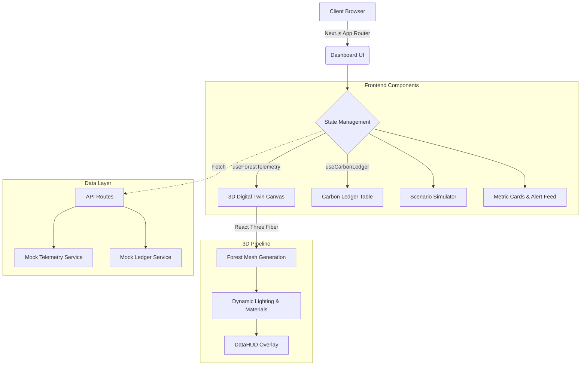

<div align="center">
  

  # ForestTwin: Digital Twin Carbon Asset Dashboard

  <p>
    <strong>An interactive forest and carbon dashboard prototype built with Next.js and mock data.</strong>
  </p>

  <p>
    <a href="https://digitaltwinfw.netlify.app/"><b>View Live Demo</b></a> •
    <a href="https://github.com/TechTideOhio/SustainableFW"><b>View Source</b></a> •
    <a href="https://techtideai.io"><b>TechTide AI</b></a>
  </p>

  <p>
    <a href="https://nextjs.org/">
      
    </a>
    <a href="https://opensource.org/licenses/MIT">
      
    </a>
  </p>
</div>

---

## 🌲 What is ForestTwin?

ForestTwin is a forest-monitoring interface prototype built by [TechTide AI](https://techtideai.io) and [Alex Cinovoj](https://alexcinovoj.com). It demonstrates 3D visualization, simulated telemetry, scenario controls, and carbon-ledger views. Its API routes return mock data; it does not verify carbon credits, connect real forest sensors, or provide production authentication.

### Core Capabilities

- **Interactive forest visualization**: React Three Fiber renders trees, seasons, and visual health indicators from demo state.
- **Telemetry overlays**: Dashboard cards and overlays display simulated carbon, canopy, and biomass metrics.
- **Scenario controls**: Sliders demonstrate how temperature, drought, and deforestation inputs can change example projections; these are not validated scientific predictions.
- **Carbon ledger**: A table presents mock ledger records for exploring the interface.
- **Alert feed**: Example environmental alerts demonstrate the monitoring layout.

## 🛠 Tech Stack & Architecture

The application uses **Next.js 16 App Router**, React Three Fiber, and Tailwind CSS. The 3D canvas supplies a fallback when WebGL is unavailable or reduced motion is requested. Browser checks remain necessary for individual components.

### Architecture Overview



### Design System (Indigo/Slate)

ForestTwin utilizes a strict **Indigo & Slate** design token system implemented via Tailwind CSS and `shadcn/ui`. All interactive elements follow a unified interaction spec:
- Spring-physics transitions via Framer Motion.
- Strict touch target compliance (≥44px).
- Uniform `.focus-ring` and active scale micro-interactions across the UI.

## 🤖 AI Search & Agents (AICL)

This repository is optimized for autonomous AI Agents (ChatGPT, Perplexity, Claude, Copilot). 

- **`llms.txt`**: A machine-readable Markdown context file is located at [`/llms.txt`](https://digitaltwinfw.netlify.app/llms.txt) outlining the product structure for AI systems.
- **`pricing.md`**: Transparent SaaS tiers formatted for AI agent evaluations are hosted at [`/pricing.md`](https://digitaltwinfw.netlify.app/pricing.md).
- **`robots.txt`**: Explicitly permits AI crawlers (`GPTBot`, `PerplexityBot`, etc.) to index and cite the platform.

## 🚀 Quick Start & Deployment

### Prerequisites

* Node.js v20+
* npm or pnpm

### Local Development

1. **Clone the repository:**
   ```bash
   git clone https://github.com/TechTideOhio/SustainableFW.git
   cd SustainableFW
   ```

2. **Install dependencies:**
   ```bash
   npm ci
   ```

3. **Start the development server:**
   ```bash
   npm run dev
   ```

### Netlify Deployment

This repository is pre-configured for seamless deployment on Netlify using native Next.js Runtime integration.
- **Build command**: `npm run build`
- **Publish directory**: `.next`

The checked-in [`netlify.toml`](netlify.toml) defines the build command, output directory, Node major version, and Next.js plugin. A connected Netlify site and successful hosted build are still required; a local build does not verify deployment, routing, or domain configuration. Preserve existing hosting settings when updating the code.

---

<div align="center">
  <p>Built with ❤️ by <a href="https://techtideai.io">TechTide AI</a></p>
</div>

## 🤝 Contributing

Contributions are welcome! Please read our [Contributing Guide](.github/CONTRIBUTING.md) and [Code of Conduct](.github/CODE_OF_CONDUCT.md) before submitting a pull request.

## 📜 License

This project is licensed under the MIT License. See the [LICENSE](LICENSE) file for details.

---

<p align="center">Built with 🌲 by <a href="https://techtideai.io">TechTide AI</a></p>

## Validation and security

Run the available repository checks before submitting changes:

```bash
npm run lint
npm run test:security
npm run build
```

The October 20, 2026 maintenance checks pass lint (18 warnings, zero errors), TypeScript, the production build, and the vendored braces regression check. There is no general unit-test suite. The app uses mock data; passing these checks does not establish live integrations or production readiness.

`test:security` verifies the vendored braces security backport; it is not a complete application test suite or security audit. Check the pages and interactions in a browser separately. Follow the [security policy](.github/SECURITY.md) for private vulnerability reports.
